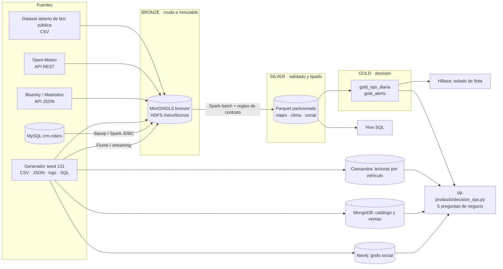

# Arquitectura medallion de NexoUrbano

## Qué motor ancla cada V

| V | Motor(es) | Por qué ese motor |
|---|---|---|
| **Volumen** | HDFS + MinIO/ADLS (almacenamiento) · Spark batch (cómputo) | Almacenamiento barato y particionado; cómputo distribuido para 1 M de viajes |
| **Variedad** | MongoDB (catálogo anidado) · Hive (schema-on-read sobre CSV) · MapReduce (texto) | Cada formato en el motor que lo modela sin forzarlo |
| **Velocidad** | Spark Structured Streaming (ventanas) · Cassandra (escritura sostenida, último estado) · Flume (ingesta de logs) | Latencia de segundos y escrituras constantes por vehículo |
| **Veracidad** | Contratos YAML + reglas en Spark (Silver) + cuarentena (DLQ) + watermark | La calidad es código, versionado y medido (ver `evidence/m1_perfilado_*.txt`) |
| **Complejidad** | Neo4j (relaciones y fraude) · HBase (rowkey salada, acceso por clave) · Cassandra (modelo por query) | La decisión de modelado ya viene dada por el patrón de consulta |

## Una carga de trabajo por motor
Series de tiempo → Cassandra · Catálogo → MongoDB · Relaciones → Neo4j · SQL analítico → Hive/Spark ·
Serving por clave → HBase · Landing → MinIO/ADLS · Legado batch → HDFS/MapReduce/Pig/Sqoop/Flume.
Las justificaciones de 5 líneas están en `ADR/`.
